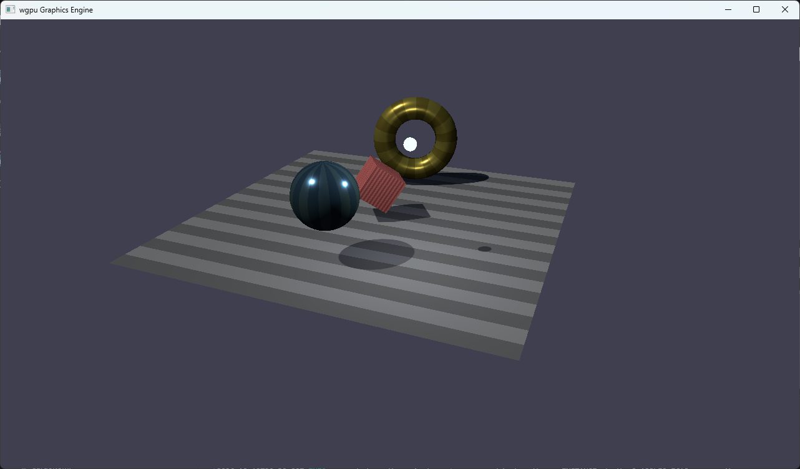

# wgpu Graphics Engine

A physically-based 3D graphics renderer written in Rust using **wgpu** and **winit**.

## Features

| Feature | Details |
|---|---|
| **PBR Shading** | Cook-Torrance GGX microfacet BRDF, metallic-roughness workflow |
| **Multiple light types** | Directional, point, and spot lights |
| **Shadow mapping** | One directional light casts a single 2048² depth map, 3×3 PCF |
| **Keyboard navigation** | WASD / Arrow keys + Q/E to fly the camera |
| **Cross-platform** | Vulkan, Metal, DX12, DX11, WebGPU backends via wgpu |

## Quick Start

### Prerequisites

- Rust **1.75+** (`rustup update stable`)
- A GPU with Vulkan, Metal, DX11, or DX12 support

### Build & Run

```bash
cd graphics_engine
cargo run --release
```

## Controls

| Key | Action |
|---|---|
| **W / ↑** | Move camera forward |
| **S / ↓** | Move camera backward |
| **A / ←** | Strafe left |
| **D / →** | Strafe right |
| **Q** | Move up |
| **E** | Move down |
| **Esc** | Quit |
| **Tab** | Capture/Uncapture mouse | 

## Architecture

```
graphics_engine/
├── Cargo.toml
├── assets/
│   └── shaders/
│       ├── opaque_lit.wgsl    # Cook-Torrance GGX PBR + shadow lookup
│       └── shadow_depth.wgsl  # Depth-only pass that fills the shadow map
└── src/
    ├── main.rs                # Entry point, event loop, demo scene
    ├── time.rs                # Clock (delta time)
    ├── input.rs               # Key bindings
    ├── scene/
    │   ├── mod.rs             # Vertex, Mesh, Material, SceneObject, Light, Scene
    │   ├── camera.rs          # Camera: view/projection and frustum helpers
    │   ├── mesh_builder.rs    # Cube, sphere, plane and torus generators
    │   └── aabb.rs            # Aabb: axis-aligned bounds
    ├── renderer/
    │   ├── mod.rs             # Engine: owns GPU state, drives both passes
    │   ├── gpu.rs             # GpuContext: adapter/device/surface init
    │   ├── pipeline.rs        # PBR and shadow pipeline creation
    │   ├── mesh_store.rs      # GPU buffers (vertex + index + bounds)
    │   ├── texture_store.rs   # Fallback textures and samplers
    │   └── uniforms.rs        # CameraUniform, LightUniform, InstanceData, ShadowUniform
    └── utils/
        └── mod.rs             # Texture loader, FPS counter, Timer
```

### Key Data Flow

```
EventLoop → main.rs
    → scene.update(clock, input)   (animate positions/rotations)
    → Engine::render(&scene)
          ├─ write CameraUniform → GPU buffer
          ├─ write LightsBlock   → GPU buffer
          ├─ fit ShadowUniform to camera frustum ∩ scene bounds
          ├─ write ShadowUniform → GPU buffer
          ├─ shadow pass  (shadow_depth.wgsl, depth only)
          │     └─ for each SceneObject: draw_indexed()
          └─ main pass  (opaque_lit.wgsl)
                └─ for each SceneObject:
                      ├─ bind InstanceData + material textures
                      └─ draw_indexed()  (samples the shadow map)
```

## Shadows

A single directional light is shadow-mapped, into one 2D depth map. The caster is
whichever directional light comes first in the scene's light list; every other
light stays unshadowed.

The pass is depth-only. `Engine::render` runs it before the main pass, rendering
the scene from the light into a `Depth32Float` target with no fragment stage and
front-face culling. Dropping the fragment stage keeps the early-Z path, so the
pass costs what the visible surface costs rather than what the overdraw costs.
Front-face culling means a fragment is never compared against its own surface,
which removes self-shadow acne at the source rather than by biasing it away.

Two things keep the fitted volume tight:

- **The volume is clipped to the scene.** `Engine::caster_bounds` unions the world bounds of the
  meshes and intersects.
- **The origin snaps to whole texels.** The fit otherwise shifts continuously as
  the camera moves, which makes shadow edges crawl.

Bias is derived per frame rather than tuned by hand. A shadow texel covers
`texel_world_size` world units, and depth varies across it by
`texel_world_size · tan θ` on a surface tilted θ from the light, so
`slope_bias = texel_world_size / depth_span` times a safety factor, with
`depth_bias` a fraction of that. Hand-tuned constants quietly stop being correct
whenever the resolution or the fitted volume changes.

Limits:

- One caster and one 2D map: no cascades, and no point or spot shadows. Casters
  beyond `SHADOW_DISTANCE` from the camera, or further than `CASTER_PAD` in front
  of the fitted volume, never reach the map.
- Only closed meshes cast. Front-face culling drops single-sided geometry, so the
  ground plane contributes nothing to the map.
- Because the far surface is what gets stored, any bias at all eats into the
  margin at a grazing silhouette, so shadow edges sit slightly inside where they
  should.

## Screenshot

